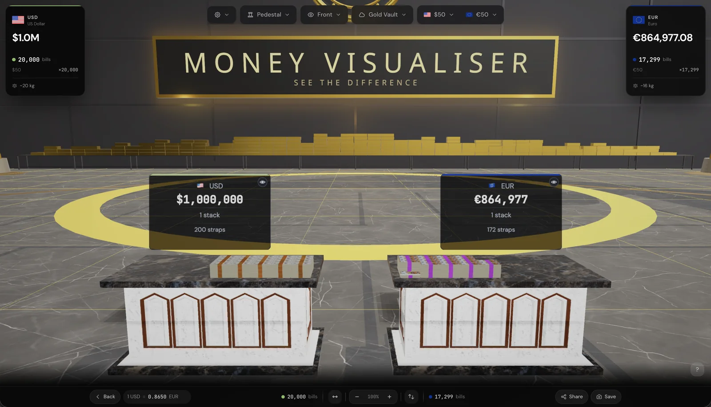

# Money Visualiser embed kit

Put a live 3D scene of real money on any web page: one stack of notes, or two currencies side by side, in a gold vault, a cash logistics warehouse, on an aircraft carrier's deck or across a floodlit football stadium. Free to embed, including on commercial sites.

<p align="center">
  
</p>

**[Build one with the configurator](https://moneyvisualiser.com/embed)** · [Embed builder in this repo](demo/index.html) · [Examples](examples/)

## Quick start

Paste this where the scene should appear:

```html
<iframe
  src="https://moneyvisualiser.com/embed/render?amount=1000000&amp;from=USD&amp;mode=single"
  width="640"
  height="480"
  title="What 1,000,000 USD looks like, in 3D"
  loading="lazy"
  style="border: 0; border-radius: 12px;">
</iframe>
```

Change the settings in the address to change the scene. Everything you can set is listed below.

## Settings

| Setting | Values | Default | What it does |
| --- | --- | --- | --- |
| `amount` | Any positive number | `1000` | The amount to show, in the `from` currency |
| `from` | A [currency code](#currencies) | `USD` | The currency of the amount |
| `to` | A [currency code](#currencies) | `EUR` | The currency to compare with, in compare mode |
| `mode` | `single`, `compare` | `compare` | One stack, or two side by side |
| `env` | See [environments](#environments) | `gold-vault` | Where the scene takes place |
| `surface` | `auto`, `pedestal`, `small-table`, `tower`, `pallet`, `trolley`, `ground` | `pedestal` | What the money stands on. `auto` picks a pillar (`small-table`), pedestal or tower to suit the amount, like the app's AUTO button |
| `camera` | `normal`, `overhead`, `side-left`, `side-right`, `diagonal`, `money-close` | `normal` | The starting camera angle |
| `zoom` | `close` | off | Start close to the money. This overrides `camera` and hides the labels |
| `showLabels` | `false` | shown | Hide the value labels on the stacks |
| `showAmounts` | `false` | shown | Hide the amount badges along the top edge of the frame |
| `showRuler` | `true` | hidden | Show a measuring ruler; drawn in compare mode on the `tower` surface |
| `stats` | `true` | hidden | Show the note count, weight and height of the stack |
| `theme` | `dark`, `light` | `dark` | Colour of the frame's badges, stats panel and credit. The 3D scene itself is lit by its environment |
| `webgl` | `true` | off | Force WebGL instead of trying WebGPU first; see [renderer](#renderer) |

Values must match exactly. The renderer replaces anything it doesn't recognise with the default, so a typo such as `env=gold` quietly gives you the gold vault and `from=XYZ` gives you US dollars. The [JavaScript helper](#javascript-helper) throws on mistakes like these before they reach your page.

Amounts have no upper limit in embeds; the Money Visualiser web app itself stops at $128 billion for a single stack. Very large amounts are heavy to draw, so check them in the preview before publishing.

### Environments

| `env` | Scene |
| --- | --- |
| `gold-vault` | A marble-and-gold bank vault. The default |
| `warehouse` | A cash logistics warehouse with racking, forklifts and loading docks |
| `aircraft-carrier` | The flight deck of a carrier at sea, with jets and deck crew |
| `football-field` | A floodlit stadium at dusk with a full crowd |
| `parking-lot` | A rooftop car park inside a works cordon |
| `minimal-grid` | Simple Room: a plain, unlimited space |

Every environment except Simple Room has a fixed floor area. When the money is physically too big for the one you chose, the scene shows it in Simple Room instead (the configurator warns you when this will happen). As a rough guide, the carrier, stadium and rooftop car park each hold around ten billion US dollars; the vault and warehouse are smaller.

### Examples

```text
Two currencies, from a diagonal angle
https://moneyvisualiser.com/embed/render?amount=50000&from=EUR&to=JPY&camera=diagonal

A billion dollars on a football field, with stats
https://moneyvisualiser.com/embed/render?amount=1000000000&from=USD&mode=single&env=football-field&surface=pallet&stats=true

Ten thousand pounds on whichever surface suits it, light badges, no amount badges
https://moneyvisualiser.com/embed/render?amount=10000&from=GBP&mode=single&surface=auto&theme=light&showAmounts=false
```

## Sizes

The configurator offers a responsive frame and three fixed sizes, plus custom sizes from 200 × 200 to 2000 × 2000 pixels.

| Size | Width × height |
| --- | --- |
| Responsive (default) | 100% wide at 16:9, 4:3, 1:1 or 9:16 |
| Small | 300 × 250 |
| Medium | 480 × 360 |
| Large | 640 × 480 |

The responsive frame fills its column at any width and keeps its shape:

```html
<div style="position: relative; width: 100%; aspect-ratio: 16 / 9; border-radius: 12px; overflow: hidden;">
  <iframe
    src="https://moneyvisualiser.com/embed/render?amount=1000000&amp;from=USD&amp;mode=single"
    title="What 1,000,000 USD looks like, in 3D"
    loading="lazy"
    style="position: absolute; inset: 0; width: 100%; height: 100%; border: 0;">
  </iframe>
</div>
```

## The one-line script

The official script builds a responsive frame for you:

```html
<script src="https://moneyvisualiser.com/embed.js" data-mv-widget data-amount="250000" data-currency="GBP" async></script>
```

Every attribute is optional. Without any, the script draws what it always has: one stack on a pallet in the gold vault, labels off, stats on, 16:9 up to 800 pixels wide. The configurator's **Script** tab writes the attributes for any scene.

| Attribute | Values | Default |
| --- | --- | --- |
| `data-amount` | Any positive number | `1000000` |
| `data-currency` (or `data-from`) | A [currency code](#currencies) | `USD` |
| `data-mode` | `single`, `compare` | `single` |
| `data-to` | A [currency code](#currencies), in compare mode | `EUR` |
| `data-env` | An [environment](#environments) | `gold-vault` |
| `data-surface` | Any `surface` value, including `auto` | `pallet` |
| `data-camera` | Any `camera` value | `normal` |
| `data-zoom` | `normal`, `close` | `normal` |
| `data-show-labels` | `true`, `false` | `false` |
| `data-show-amounts` | `true`, `false` | `true` |
| `data-show-ruler` | `true`, `false` | `false` |
| `data-show-stats` | `true`, `false` | `true` |
| `data-theme` | `dark`, `light` | `dark` |
| `data-renderer` | `auto`, `webgl` | `auto` |
| `data-aspect-ratio` | A ratio such as `16/9`, `4/3` or `640/480` | `16/9` |
| `data-max-width` | Pixels, or `none` to fill the column | `800` |

Each tag is built once, so several scripts on one page each produce exactly one frame.

## Tools

Five Money Visualiser tools can also be embedded. Each opens in its default state, and readers enter their own figures inside it.

| Tool | Embed address |
| --- | --- |
| What Does X Look Like? | `https://moneyvisualiser.com/tools/what-does-x-look-like/embed` |
| Cash Stack Calculator | `https://moneyvisualiser.com/tools/cash-stack-calculator/embed` |
| Denomination Mix Optimizer | `https://moneyvisualiser.com/tools/denomination-mix-optimizer/embed` |
| Carryability Planner | `https://moneyvisualiser.com/tools/carryability-planner/embed` |
| Value Density Index | `https://moneyvisualiser.com/tools/value-density-index/embed` |

```html
<iframe src="https://moneyvisualiser.com/tools/cash-stack-calculator/embed"
  style="width:100%;height:600px;border:none;border-radius:12px"
  title="Cash Stack Calculator" loading="lazy"></iframe>
```

## JavaScript helper

A small, dependency-free module that builds embed addresses and snippets, and rejects values the renderer would not understand.

```bash
npm install github:Rising-Throne/moneyvisualiser-embed
```

```js
import { embedCode, embedUrl, responsiveEmbedCode, scriptCode } from 'moneyvisualiser-embed';

embedUrl({ amount: 1_000_000, from: 'USD', mode: 'single', environment: 'warehouse', stats: true });
// https://moneyvisualiser.com/embed/render?amount=1000000&from=USD&mode=single&env=warehouse&stats=true

embedCode({ amount: 50_000, from: 'EUR', to: 'JPY' }, { width: 480, height: 360 });
// <iframe src="…" width="480" height="360" title="50,000 EUR compared with JPY, in 3D" …>

responsiveEmbedCode({ amount: 1e9, mode: 'single', surface: 'auto' }, { aspectRatio: '4 / 3' });
// <div style="… aspect-ratio: 4 / 3 …"><iframe …></iframe></div>

scriptCode({ amount: 250_000, from: 'GBP', theme: 'light' }, { maxWidth: 'none' });
// <script src="https://moneyvisualiser.com/embed.js" data-mv-widget data-amount="250000" …></script>

embedUrl({ environment: 'gold' });
// TypeError: environment must be one of gold-vault, warehouse, aircraft-carrier, …
```

The options use readable names (`environment`, `closeUp`, `labels`, `amounts`, `ruler`, `renderer`); TypeScript types are included. A React component is in [`examples/react`](examples/react/MoneyVisualiserEmbed.tsx).

## Currencies

Embeds support 82 currencies.

<details>
<summary>Show all currency codes</summary>

AED, AFN, ALL, AMD, ARS, AUD, AZN, BDT, BHD, BOB, BRL, BYN, CAD, CHF, CLP, CNY, COP, CUP, CZK, DKK, DZD, EGP, ETB, EUR, GBP, GEL, GHS, HKD, HUF, IDR, ILS, INR, IQD, ISK, JOD, JPY, KES, KRW, KWD, KZT, LKR, LYD, MAD, MDL, MKD, MMK, MNT, MXN, MYR, NGN, NOK, NZD, OMR, PEN, PHP, PKR, PLN, PYG, QAR, RON, RSD, RUB, SAR, SDG, SEK, SGD, SOS, THB, TJS, TND, TRY, TWD, TZS, UAH, USD, UYU, UZS, VEF, VND, XAF, XOF, ZAR

Names for each code are in [`src/currencies.js`](src/currencies.js). Crypto and precious metals are available in the web app but not in embeds.

</details>

## Renderer

Embeds draw with **WebGPU** where the visitor's browser supports it and fall back to **WebGL** automatically, including when the GPU fails partway through. Every current desktop and mobile browser can show the scene. Add `webgl=true` (or `renderer: 'webgl'` in the helper, `data-renderer="webgl"` on the script) to skip WebGPU entirely, for example if a page already runs other heavy WebGPU content.

## What runs inside the embed

- **No ads, no cookie banner, no consent prompt and no analytics.** None of them load inside the frame.
- **Live exchange rates**, fetched from Money Visualiser when the scene opens.
- **A small "Powered by" credit** in the corner. It opens the same scene in the full Money Visualiser app.
- The embed's interface is in English.

## If your site restricts frames

- **Content Security Policy:** allow the embed with `frame-src https://moneyvisualiser.com`. The one-line script also needs `script-src https://moneyvisualiser.com`.
- **Sandboxed frames:** if you add a `sandbox` attribute, include `allow-scripts allow-same-origin allow-popups allow-popups-to-escape-sandbox`, the same set the official script uses.

## Using the embeds

- Embed them on any site, including commercial ones, at no cost.
- Keep the built-in credit visible: don't cover, crop or hide it.
- Don't present the scene as your own product, or suggest that Money Visualiser endorses your site.

## Troubleshooting

| What you see | Likely cause |
| --- | --- |
| A blank frame | Your site's Content Security Policy blocks it; see above |
| "Refused to connect" | The address points at `moneyvisualiser.com/embed` (the configurator) instead of `/embed/render` |
| The wrong scene | A setting is misspelled and fell back to its default; check it against the table, or build the address with the helper |
| Simple Room instead of your environment | The amount is too big for that environment's floor; pick a bigger one or a smaller amount |
| No ruler | The ruler is only drawn in compare mode on the `tower` surface |
| An old `/widget/render` address | Still works: it redirects to `/embed/render`, keeping its settings |

## Licence

The code in this repository is MIT licensed ([`LICENSE`](LICENSE)). Money Visualiser itself, including the embedded scenes, belongs to Rising Throne and is not covered by that licence.

Questions or partnerships: [contact@therisingthrone.com](mailto:contact@therisingthrone.com).
